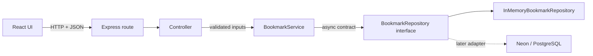

# Backend architecture guide

This guide describes the current API as a teaching project. The goal is to keep HTTP handling, application rules, and storage separate so each part has one job and the in-memory database can later be replaced by Neon/PostgreSQL.

## 1. The request path

For `GET /api/collections/:id/links`, the sequence depends on visibility:

1. Express matches the route and calls the controller method.
2. The controller reads `collectionId` and the `Authorization` header.
3. For a private collection, the service hashes the presented token, looks up the matching session, checks its collection and expiry, and rejects the request if any check fails. For a public collection, no session is required to read links.
4. The service asks the repository for that collection's links.
5. The controller returns status 200 with `{ "data": [...] }`. Link mutations remain session-protected for both visibility settings.

The browser groups those records by their normalized `domain`. Grouping is a display concern, so it lives on the frontend and does not change the API's link records.

## 2. Data types and their roles

### `Collection`

The public collection DTO: `id`, `name`, `description`, `visibility`, `createdAt`, `updatedAt`, and `linkCount`. Visibility is immutable after creation. `linkCount` is computed from links; it is not a separately edited counter, which prevents it drifting out of sync.

### `StoredCollection`

The repository's private record adds `passwordHash` (null for public collections) and `deletePasswordHash`. Neither hash may be returned to the browser. `BookmarkService.toPublicCollection` removes both while building the DTO. The plaintext collection password is accepted only during private collection creation/unlock; the deletion password is generated by the server and returned once during creation. Neither plaintext credential is stored.

### `SavedLink`

One bookmark record has an ID, owning collection ID, normalized URL, normalized domain, title, note, and creation time. The collection ID is the ownership boundary: reads and changes are checked against it.

### `CollectionSession`

A temporary grant contains its own ID, collection ID, token hash, creation time, and expiry. It does not contain the raw bearer token. The raw token is returned once to the caller after collection creation or password verification.

### Input and result interfaces

`CreateCollectionInput`, `UpdateCollectionInput`, and `CreateLinkInput` describe what callers may send. The discriminated `visibility` field makes the collection password required for `private` and absent for `public`. `CreateCollectionResult` combines the public collection, initial short-lived session, and one-time deletion password. These types make controller/service contracts readable; Zod performs the corresponding runtime checks because TypeScript types are erased when JavaScript runs.

## 3. Interfaces and dependency direction

`BookmarkRepository` is a TypeScript interface: it lists operations and Promise-based return types without saying how data is stored. The service depends on that interface, not on `Map` or a database driver.

The Promise return types matter. A Map lookup finishes synchronously, but PostgreSQL queries are asynchronous. Returning Promises now means a future adapter can await Neon calls without changing the service method shape. `InMemoryBookmarkRepository implements BookmarkRepository` makes TypeScript verify that the development adapter supplies every required operation.

The dependency direction is intentional:

- Routes depend on the controller.
- The controller depends on the service.
- The service depends on the repository interface.
- The app composition root chooses the concrete repository.

That final choice is in `src/server.ts`: the running API passes `NeonBookmarkRepository`, while tests can pass a fresh memory repository to `createApp`. Storage details do not leak into route/controller code.

## 4. Collection passwords and sessions

### Creating a collection

1. The browser sends name, description, and visibility to `POST /api/collections`; a private collection also includes its password.
2. The controller validates the body with a Zod discriminated union, so public collections cannot set a collection password and private collections cannot omit one.
3. The service trims text, hashes the optional collection password with a unique salt using Node's scrypt, generates a separate random deletion password, hashes that secret, and gives the hashes to the repository.
4. The service creates an initial session so the creator can manage links without a second password prompt.
5. A cryptographically random 256-bit session token is returned once. The repository stores only its SHA-256 hash and a 12-hour expiry. The deletion password is also returned once; only its scrypt hash is stored. Because this project has no accounts or identity provider, “creator-only” is enforced through possession of this unguessable secret: anyone the creator shares it with can also delete the collection.
6. The response contains the public collection DTO, session token and expiry, and one-time deletion password. It contains neither credential hash.

### Unlocking later

For a private collection the browser posts its password to `/api/collections/:id/sessions`. The service loads the stored record and uses constant-time comparison to verify the scrypt result. On success it returns a new random token. Wrong passwords return 401. Public collections need no session to read links, and cannot mint sessions through this endpoint.

### Using and closing a session

For link mutations and private link reads, the browser sends `Authorization: Bearer <token>`. The controller extracts it; the service hashes it and checks that the session exists, belongs to the requested collection, and has not expired. An expired session is removed and the request gets 401. Public link reads do not need that header. Deleting `/sessions/current` revokes that token hash. Deleting a collection requires its separate one-time deletion password in the JSON body; the service verifies its hash and then cascades to links and sessions. This means the deletion password is distinct from ordinary access and never appears in URLs or logs as a query parameter.

The in-memory session repository is for learning and local use. A production version needs throttling for password attempts and a deliberate browser credential strategy. Secure, HttpOnly, SameSite cookies over HTTPS reduce exposure to script access compared with localStorage. This local frontend keeps the bearer token in `sessionStorage` only for the tab lifetime.

Collection names and counts are public metadata so the accountless home page can list collections. Public link contents are readable by anyone; private links require a session. Link edits require a session in either mode. Visibility has no update field and therefore cannot be switched after creation. The UI displays the visibility before creation and requires the creator to acknowledge and save the generated deletion password before continuing. The detail page can download collection metadata and links as JSON.

## 5. Domain normalization and validation

The controller accepts a URL with or without `http://` or `https://`. Missing schemes get `https://`; other protocols and embedded credentials are rejected. The service parses the URL, lowercases the hostname, and removes a leading `www.`. That is why `github.com/sdda` and `https://www.github.com/32424` both have domain `github.com`.

Zod validates user input at the HTTP boundary. `HttpError` carries expected status codes for application failures. The final Express error handler converts Zod issues to a 400 response, `HttpError` to its selected status, and unexpected exceptions to a generic 500 without returning internal stack details.

## 6. Neon/PostgreSQL adapter and migrations

The running API uses `NeonBookmarkRepository`, which implements the same Promise-based `BookmarkRepository` interface with parameterized `pg` queries. `createApp` still defaults to `InMemoryBookmarkRepository` for tests that need fast, isolated data. The in-memory adapter seeds one `design` collection and five example links; its demo password is `design-demo`. The Neon database starts empty and survives process restarts.

The schema migration in `src/db/migrations.ts` creates:

- `collections`, including a visibility/password consistency constraint;
- `links`, with a cascading collection foreign key and collection/time index;
- `collection_sessions`, with a cascading collection foreign key, unique token hashes, and collection index;
- `schema_migrations`, which records applied schema versions.

At startup, the server applies migrations using `DATABASE_URL_UNPOOLED` (Neon's direct connection). A transaction-scoped advisory lock prevents two server instances from applying the same migration concurrently. API queries use `DATABASE_URL`, Neon’s pooled URL. Both values are populated locally by `neon env pull`; neither belongs in Git. The startup migration is atomic, and its version record makes later starts a no-op until a new version is added.

Collection deletion relies on PostgreSQL `ON DELETE CASCADE` to remove its links and sessions. Password hashing and session expiry checks remain in `BookmarkService`, so switching storage does not change the API routes or DTOs.

Password hashes and token hashes remain hashes in the database. Never migrate raw passwords or raw session tokens.

## 7. Tests

Tests are arranged by boundary. Password tests cover salted hashing, verification, and token hashing. Repository tests cover CRUD, cascade deletion, and session storage. Service tests cover correct/wrong passwords, ownership, expiration, and link rules. Supertest exercises the HTTP layer end to end, including visibility-dependent reads, password validation, deletion-password verification, bearer authorization, status codes, and JSON response shapes.
